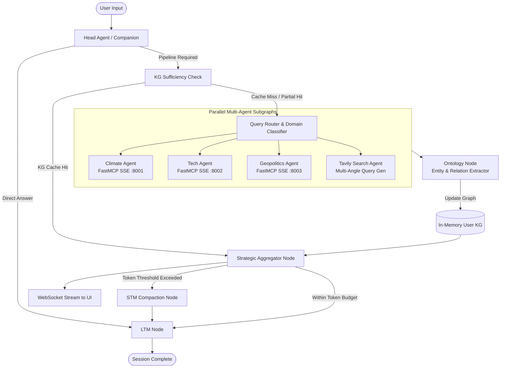

<div align="center">

# 🌐 Jambavanth: Global Ontology Engine

**An Autonomous Multi-Agent Intelligence Platform & Dynamic Knowledge Graph Synthesis System**

[](https://www.python.org/)
[](https://langchain-ai.github.io/langgraph/)
[-4B32C3?style=for-the-badge)](https://github.com/jlowin/fastmcp)
[](https://groq.com/)
[](https://github.com/facebookresearch/faiss)
[](https://flask-socketio.readthedocs.io/)

</div>

---

## 📌 Overview

Traditional LLMs suffer from stale training data, context fragmentation, and hallucinations when answering multi-dimensional queries. **Jambavanth (Global Ontology Engine)** solves this by decoupling raw data collection from synthesis:

1. Specialised **ReAct subagents** fetch real-time multi-domain data (Climate, Tech, Geopolitics, and Web Search) via **Model Context Protocol (MCP)** microservices.
2. An **Ontology Extraction Engine** maps entities and cross-domain relationships into a dynamic, user-isolated **Knowledge Graph**.
3. A **Semantic Sufficiency Gatekeeper** checks the existing Knowledge Graph before triggering expensive multi-agent research.
4. An **Aggregator Agent** synthesizes structured cross-domain insights and streams responses in real-time over WebSockets.

---

## 🏗️ Architecture & Workflow



---

## ✨ Key Features

- **Distributed Multi-Agent Architecture**:
  - Built with **LangGraph** using hierarchical state graphs, conditional routing, and `asyncio.gather` parallel execution.
  - Subgraphs leverage the ReAct pattern via `ToolNode` and `tools_condition`.
- **Model Context Protocol (FastMCP over SSE)**:
  - Independent microservices running on dedicated ports (`8001`, `8002`, `8003`), delivering climate observations, global news, and tech intelligence.
  - Dynamically bound to agents via `langchain-mcp-adapters`.
- **Self-Evolving Knowledge Graph**:
  - Automatically extracts nodes (People, Locations, Technologies, Metrics, Policies) and directed edges (`LOCATED_IN`, `IMPACTS`, `ANNOUNCED_BY`).
  - Graph is rendered interactively in the web UI.
- **Smart Sufficiency Caching**:
  - Evaluates whether previously gathered knowledge graph data is complete enough to answer follow-up queries without redundant network requests.
- **Dual-Tier Memory Architecture**:
  - **Short-Term Memory (STM)**: Dynamic context compaction using token-level tracking (`count_tokens_approximately`) against Groq TPM thresholds.
  - **Long-Term Memory (LTM)**: Per-user FAISS vector store with `ibm-granite/granite-embedding-30m-english` embeddings for cross-session preference recall.
- **Real-Time Interactive UI**:
  - Built with Flask, Socket.IO, and Vis.js.
  - Provides live token streaming, agent journey tracking, and interactive graph exploration.

---

## 📂 Repository Structure

```text
Jambavanth/
├── agent/
│   ├── config.py              # LLM models (Groq), prompts, thresholds, and URLs
│   ├── domain_graph.py        # Climate, Tech, Geopolitics ReAct subgraphs
│   ├── knowledge_graph.py     # In-memory graph engine with entity/relation indexing
│   ├── ltm.py                 # Long-term memory store (FAISS + Granite embeddings)
│   ├── ontology_graph.py      # Core LangGraph orchestration workflow
│   ├── schemas.py             # Pydantic schemas for structured outputs
│   ├── state.py               # LangGraph ChatState and subgraph states
│   ├── stm.py                 # Short-term memory summarizer and token counter
│   └── tavily_search.py       # Multi-query agentic web search workflow
├── mcp_servers/
│   ├── climate/               # FastMCP server: NASA POWER & OpenWeatherMap APIs (:8001)
│   ├── tech/                  # FastMCP server: The Guardian Technology API (:8002)
│   └── geopolitics/           # FastMCP server: GNews World Intelligence API (:8003)
├── UI/                        # HTML templates (Login, Dashboard, Chat Interface)
├── static/                    # Frontend styling, Vis.js graph UI, and Socket.IO client
├── app.py                     # Flask-SocketIO backend server with streaming pipeline
├── auth.py                    # User authentication and session token handling
├── chat_agent.py              # User session manager and LangGraph thread checkpointer
├── langgraph.json             # LangGraph Platform deployment configuration
├── requirements.txt           # Python package dependencies
└── pyproject.toml             # Project build configuration
```

---

## 🛠️ Tech Stack

| Component | Technology |
|---|---|
| **Agent Orchestration** | [LangGraph](https://github.com/langchain-ai/langgraph), [LangChain Core](https://github.com/langchain-ai/langchain) |
| **LLM Provider** | [Groq](https://groq.com/) (`Llama 3.3 70B Versatile`, `Llama 4 Scout 17B`, `Llama 3.1 8B`) |
| **MCP Microservices** | [FastMCP](https://github.com/jlowin/fastmcp), `langchain-mcp-adapters` |
| **Vector Embeddings** | [HuggingFace Embeddings](https://huggingface.co/) (`ibm-granite/granite-embedding-30m-english`), [FAISS](https://github.com/facebookresearch/faiss) |
| **Web Research** | [Tavily AI](https://tavily.com/) |
| **Backend & WebSockets** | Python, [Flask](https://flask.palletsprojects.com/), [Flask-SocketIO](https://flask-socketio.readthedocs.io/) |
| **Graph Visualization** | Vis.js Network, Modern Glassmorphic CSS |

---

## 🚀 Getting Started

### 1. Prerequisites
- Python 3.11 or higher
- Git

### 2. Clone the Repository
```bash
git clone https://github.com/your-username/jambavanth.git
cd jambavanth
```

### 3. Create a Virtual Environment & Install Dependencies
```bash
python -m venv venv

# On Linux/macOS:
source venv/bin/activate

# On Windows:
venv\Scripts\activate

pip install -r requirements.txt
```

### 4. Configure Environment Variables
Create a `.env` file in the root directory:
```env
# Core LLM & Search
GROQ_API_KEY=your_groq_api_key_here
TAVILY_API_KEY=your_tavily_api_key_here

# MCP Server Endpoints (Defaults)
CLIMATE_MCP_URL=http://localhost:8001/sse
TECH_MCP_URL=http://localhost:8002/sse
GEOPOLITICS_MCP_URL=http://localhost:8003/sse

# Tool API Keys for MCP Servers
OPENWEATHER_API_KEY=your_openweather_api_key_here
GUARDIAN_API_KEY=your_guardian_api_key_here
GNEWS_API_KEY=your_gnews_api_key_here
```

---

## ⚡ Running the System

To run the complete system, launch the three MCP microservices and the primary Flask application:

### Step 1: Start MCP Microservices
Run each in a separate terminal:

```bash
# Terminal 1: Climate Server (Port 8001)
python mcp_servers/climate/climate_mcp.py

# Terminal 2: Tech Server (Port 8002)
python mcp_servers/tech/tech_mcp.py

# Terminal 3: Geopolitics Server (Port 8003)
python mcp_servers/geopolitics/geoplotics_mcp.py
```

### Step 2: Start the Main Application
```bash
# Terminal 4: Flask Web Application & WebSocket Server
python app.py
```

Open your browser and navigate to:
```text
http://localhost:5000
```

---

## 📈 Example Query Flow

1. **User asks**: *"How are severe droughts in East Africa impacting global agricultural tech investments?"*
2. **Head Agent**: Classifies query as complex; emits an immediate acknowledgment: *"On it — analyzing climate patterns and agtech news."*
3. **KG Sufficiency Gate**: Checks graph. If missing data, routes to `first_call`.
4. **Parallel Fetching**:
   - **Climate Agent**: Calls coordinates & precipitation tools for East Africa.
   - **Tech Agent**: Searches news for agricultural technology and climate VC investments.
   - **Tavily Agent**: Formulates 4 distinct web research queries.
5. **Ontology Extraction**: Parses entities (`East Africa`, `Drought`, `AgTech VC`) and connects them (`IMPACTS`, `INVESTED_IN`).
6. **Aggregator Node**: Generates an executive briefing contextualized for strategic decision-making and streams tokens directly to the client.

---

## 🤝 Contributing

Contributions, issues, and feature requests are welcome! Feel free to check the [issues page](https://github.com/your-username/jambavanth/issues).

---

## 📄 License

Distributed under the MIT License. See `LICENSE` for more information.
